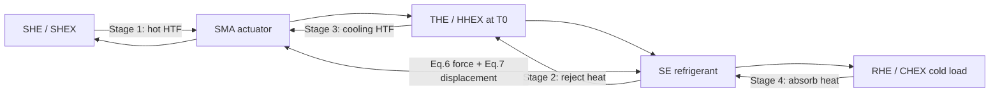
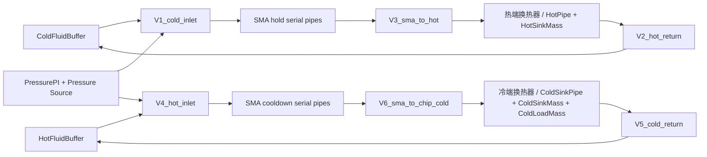
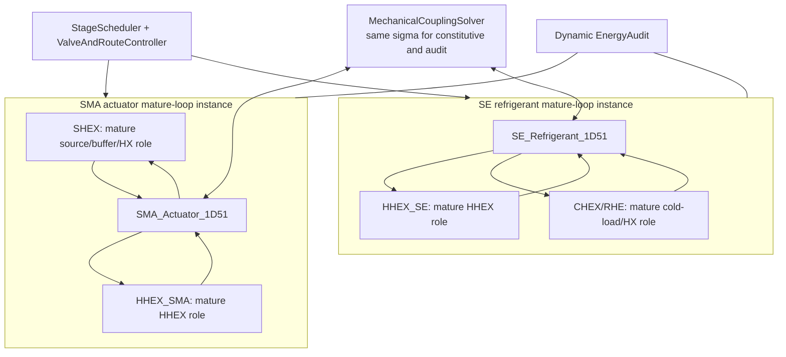

# Agent2 第五轮修改前拓扑与复用审计

## 1. 审计范围与门槛结论

本文件在修改任何 `.slx` 前完成，依据：

- `项目文档/任务书/Agent2_第五轮任务书.txt`
- 论文 *Elastocaloric cooler for waste heat recovery from perovskite solar cell with electricity and cooling production* 第 2.2 节、Fig.3、Eq.6-Eq.24
- `gx101r1_R69_remote/nixunhuan_solver101_internal.slx`
- `Build_nixunhuan_solver101_internal.m`
- `Build_Simulink_Exchange_Model.m`
- `Build_Simulink_Exchange_Params.m`
- `Run_Simulink_Exchange_Hook.m`

修改前自检结论：

| 检查 | 结果 | 证据 |
|---|---:|---|
| 成熟底座文件存在且由 Git 跟踪 | PASS | `nixunhuan_solver101_internal.slx` |
| 原底座 SHA256 已记录 | PASS | `17DF6BA77CA6EE3521E4C406F6FEA648273802AEAF970305806635F1FCA133A6` |
| 原底座 1-cycle 可完成 | PASS | `run_result.ok=1`，四阶段均 `ok=1` |
| 原底座第五轮前 physics contract | FAIL/基线缺陷 | `physics_ok=0`；旧 static contract 仍要求 R69 已删除的 transit pipe |
| `ColdFluidBuffer` 根块实体 | FAIL/基线缺口 | 当前提交模型只有相关探针，目标模型需复制成熟同类 buffer |
| 论文两回路和四阶段路径已明确 | PASS | 下述论文流路图和逐阶段映射 |
| 成熟块复用边界已明确 | PASS | 下述部件复用审计 |
| 目标拓扑已明确 | PASS | 两个成熟同类流体网络实例，SMA/SE 各一个 |
| 可以开始复制模型 | PASS | 仅允许复制，不覆盖原底座 |

原模型基线失败不是第五轮修改造成的。第五轮报告必须保留以下事实：

1. `Validate_GX101R1_Static_Contract` 的 `official_end_contract_ok=false`。
2. `transit_pipe_contract_ok=false`，因为 R69 对称冷端已明确删除独立 transit pipe，而旧 contract 尚未同步。
3. 原 1-cycle `run_result.ok=1`，但 `physics_ok=0`、`energy_audit_ok=0`、`state_sync_contract_ok=0`。
4. 原底座文件在基线运行前后 SHA256 相同。
5. 当前模型根层缺少任务书所列 `ColdFluidBuffer` 实体；第五轮按“数量不足时复制成熟同类部件”规则，从成熟 `HotFluidBuffer` 复制补齐，内部参数保持不变。

## 2. 论文 Fig.3 / 2.2 四阶段流路图

论文物理顺序：

1. `sma_heat_load`：SHE/SHEX 加热 SMA；SMA 马氏体向奥氏体转变并驱动 SE 加载。
2. `se_reject_heat`：SE 保持高载，向 THE/HHEX 放热。
3. `sma_cool_unload`：THE/HHEX 冷却 SMA；SMA 回复并实时卸载 SE。
4. `se_absorb_heat`：SE 低载，从 RHE/CHEX 冷负载吸热并返回 R1。

## 3. 成熟模型现有拓扑

成熟模型根层存在：

- 缓冲液：`HotFluidBuffer`；`ColdFluidBuffer` 在构建代码中定义，但当前提交模型实体缺失，目标模型将复制成熟同类块补齐
- 泵压与 PI：`Pressure Source (TL)`、`PressurePI_*`
- 六阀：`V1_cold_inlet`、`V2_hot_return`、`V3_sma_to_hot`、`V4_hot_inlet`、`V5_cold_return`、`V6_sma_to_chip_cold`
- 双路径热对象：`SMA`
- 热端：`热端换热器/HotPipe`、`热端换热器/HotSinkMass`
- 冷端：`冷端换热器/ColdSinkPipe`、`冷端换热器/ColdSinkMass`、`冷端换热器/ColdLoadMass`
- 流量和真实端口温度探针：`FlowSensor_*`、`*FluidTempSensor`

成熟 `SMA` 内部结构可作为一维对象模板：

- `HoldPipe_NNN` 串联流体路径；
- `CooldownPipe_NNN` 串联流体路径；
- 每节点 `Thermal Mass`；
- 相邻节点 `Conductive Heat Transfer`；
- 每节点温度探针；
- 两条路径分别经成熟 thermal gate 与固体节点换热。

第五轮不得复用其圆薄板半径、径向质量、51->101 映射语义；但可复制上述 Pipe、thermal gate、Thermal Mass、导热和探针结构，并将参数来源改为一维 `L/S`。

## 4. 第五轮目标拓扑

目标使用两个相互独立的成熟流体网络实例，避免冷热污染：

1. **SMA actuator loop**：复制成熟同类回路实例。
   - 成熟 hold 路径重定义为 `SHEX <-> SMA actuator`。
   - 成熟 cooldown 路径重定义为 `HHEX_SMA <-> SMA actuator`。
2. **SE refrigerant loop**：新主模型中原成熟回路实例。
   - 成熟 hold 路径重定义为 `HHEX_SE <-> SE refrigerant`。
   - 成熟 cooldown 路径重定义为 `CHEX/RHE <-> SE refrigerant`。
3. 两实例仅通过顶层 `MechanicalCouplingSolver` 交换机械状态，不共享流体状态。
4. 两实例均保留成熟 Pipe、buffer、换热器质量/热容、Pressure PI、V1-V6 模板和端口探针。

## 5. 四阶段逐路径映射表

完整 CSV：`项目文档/审核分析/Agent2_第五轮逐阶段路径映射表.csv`。

阀门名称在两个实例中保留，但增加实例前缀：

- `SMA/V1...V6`：SMA actuator 流体回路；
- `SE/V1...V6`：SE refrigerant 流体回路。

活动阀矩阵：

| Stage | SMA instance | SE instance | 活动泵 | 关闭支路 |
|---|---|---|---|---|
| 1 | V1,V2,V3；hold path=SHEX | 全关 | SMA PI/pump | SMA HHEX、SE HHEX、SE CHEX |
| 2 | 全关/高温滞留 | V1,V2,V3；hold path=HHEX_SE | SE PI/pump | SMA 两支路、SE CHEX |
| 3 | V4,V5,V6；cooldown path=HHEX_SMA | 全关 | SMA PI/pump | SMA SHEX、SE 两支路 |
| 4 | 全关/低温滞留 | V4,V5,V6；cooldown path=CHEX/RHE | SE PI/pump | SMA 两支路、SE HHEX |

## 6. 部件复用审计表

完整 CSV：`项目文档/审核分析/Agent2_第五轮部件复用审计表.csv`。

| 原成熟部件 | 第五轮动作 | 内部参数 |
|---|---|---|
| `HotFluidBuffer` / `ColdFluidBuffer` | 两回路实例中原样保留，重定义系统角色 | 不改 |
| `热端换热器/HotPipe`、`HotSinkMass` | 原样复用为 SHEX/HHEX 同类模板 | 不改 |
| `冷端换热器/ColdSinkPipe`、`ColdSinkMass`、`ColdLoadMass` | 原样复用为 HHEX_SMA/CHEX-RHE 同类模板 | 不改 |
| `PressurePI_*`、压力源、流量传感器 | 每回路原样复用，只改目标/使能时序 | PI 参数不改 |
| V1-V6、`ValveCommandFromWorkspace` | 每回路原样复用，只改阶段矩阵 | 阀内部参数不改 |
| Pipe、thermal gate、端口温度探针 | 复制成熟同类模块 | 内部参数不改 |
| 原 `SMA/Subsystem2` 固体接口 | 结构模板复用，改为 51 节点轴向 SMA/SE | 质量/导热参数改由论文 L/S 推导 |
| 圆薄板 GlobalXi/u/w/半径/径向映射 | 隔离，不进入第五轮主求解 | 不适用 |

## 7. 修改前自检

允许开始 `.slx` 修改的条件均满足：

- [x] 已完整阅读第五轮任务书和全部指定资料。
- [x] 已核对论文四阶段流路。
- [x] 已记录原底座哈希并确认运行后未变化。
- [x] 已运行原模型静态 contract 和 1-cycle baseline。
- [x] 已明确原模型基线失败项，不把它们归因于第五轮。
- [x] 已明确两回路目标拓扑、阀门矩阵和 Pressure PI 活动阶段。
- [x] 已明确所有成熟部件默认只复制/重接线，不改内部参数。
- [x] 已明确只有 51 节点 SMA/SE 固体接口、机械耦合、阶段控制和审计允许新增/改造。
